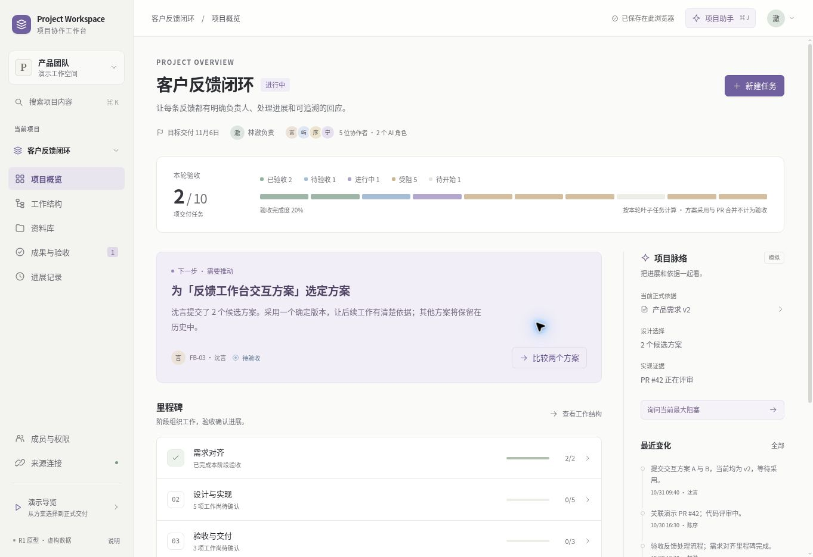

# Project Collaboration Workspace

**面向小型软件团队的项目协作与成果验收工作台 · R1 可交互产品原型**

让项目负责人能判断：目标是什么、谁在推进、采用了哪份资料和方案、实现在哪里、哪些成果尚未验收，以及下一步应由谁推动。

本轮交付是独立产品设计和可运行原型，适合展示 AI 产品经理 / B 端软件产品经理的产品判断、交互和架构能力。**全部成员、项目资料、PR 与业务事件均为虚构示例；GitHub / Google Drive 同步和 AI 均为显式模拟。**没有真实用户指标、真实 OAuth、真实大模型调用或生产部署。

## 立即运行

需要 Node.js 22 或以上；本轮实际验证环境见 [测试记录](docs/verification.md)。**零运行时第三方依赖**，无需 API Key、数据库或账号。

```bash
git clone https://github.com/haohongfei2001-png/project-collaboration-workspace.git
cd project-collaboration-workspace
git switch design/prototype-r1-20261031
npm ci --ignore-scripts
npm run dev
```

浏览器打开 `http://localhost:3000`。

```bash
npm test        # 领域规则、权限反例、来源变化与完整交付流程
npm run build  # 生成 dist/ 静态站点和单文件原型
npm run check  # 语法检查、领域测试、构建及单文件脚本编译
npm run preview # 浏览器查看构建结果
```

`npm run build` 同时生成 **`dist/Project-Workspace-R1.html`**。下载后可直接双击在浏览器打开；全部 CSS、脚本、图标和示例数据已内嵌，不依赖 CDN。浏览器若限制 `file:` 页面存储，可使用本地服务运行，或通过“导出演示记录”留存当前状态。构建目录中有 SHA-256 清单。

GitHub Actions 在本 PR / 开发分支执行同样的检查，并上传 `project-workspace-r1` 构建产物；它不发布网站。远端实际运行状态以 PR Checks 为准。

## 核心体验



| 入口 | 能真正操作什么 |
| --- | --- |
| 项目概览 | 理解目标、验收范围、下一项需推进的工作和近期变化；直接打开任务与来源 |
| 工作结构 | 按里程碑和父子关系组织任务，创建、指派、编辑、设置状态，关联资料和前置依赖 |
| 资料库 | 登记模拟来源快照，查看当前与历史版本、被哪些任务采用、更新后复核依据 |
| 成果与验收 | 提交候选方案，按同一任务比较、采用确定版本并保留理由；逐项验收，再确认本轮交付 |
| 进展记录 | 检查人、AI 和同步事件留下的记录、正式选择和交付历史 |
| 项目助手 | 用确定性规则读取获准上下文，给出可定位的任务 / 来源引用，起草任务并展示完整变更供审核 |
| 成员与权限 | 切换 6 个虚构人类身份；验证工作与来源权限差异、两个 AI 角色的不同能力 |
| 来源连接 | 模拟 GitHub PR 合并、Drive 版本更新、撤权和恢复；重复事件不会重复推进 |

### 两条演示路线

**完整示例：**默认项目“客户反馈闭环”，5 位执行成员 + 1 位观察者、2 个 AI 角色、3 个里程碑。初始有 11 行工作，其中 10 项叶子任务计入本轮范围，2 项已验收。两个设计候选是明确标记的**预置模拟提交**，不是已访谈真实设计团队的成果。也可使用“客户反馈闭环模板”创建一个独立演示项目副本。

**从空白创建：**项目选择器 → 创建项目 → 空白项目。填写目标后，可创建任务、登记资料、由任务负责人提交多个候选方案、切换负责人采用、提交与验收，最后交付。原项目保留。手工登记的任意资料不会被套用内置反馈项目的同步脚本或 AI 任务拆分；手工 GitHub 内容仅是参考快照，不代表已核验的 PR 状态。真实通用语义理解待接入模型。

默认示例的推荐操作顺序：

1. 概览 → 比较 A“流程看板”与 B“上下文收件箱”，写理由并采用 B 的 v2。
2. 在任务详情验收 `FB-03`。确认采用本身没有把任务直接标为已验收。
3. 来源连接 → 同步 PR 合并。`FB-04` 进入待验收，项目不会自动交付。
4. 来源连接 → 同步需求 v3。固定引用仍是 v2；打开相关任务，阅读新内容，明确复核。
5. 项目助手 → 询问阻塞、点击引用；请求任务草案，查看每项的负责人、日期、条件、依赖和来源，再批准。
6. 切换顾乔，尝试越权写入；返回林澈继续推进。预算资料不进入观察者及 AI 的可读范围。
7. 按依赖完成提交与逐项验收，确认本轮交付，查看正式记录。

需要复演时，使用“说明 → 恢复演示状态”。只替换内置 `feedback` 项目，不删除新建项目。

## 重要产品规则

- **工作树、依赖、来源版本、采用决策分开建模。**工作分解只能有一个父项，依赖单独检查有向环。
- **采用不是验收。**同一任务可有多个方案，采用指向具体版本；不采用的方案保留。
- **PR 合并不是验收。**合并事件只能提供实现证据和待验收状态。
- **进度可解释。**分母为本轮叶子交付任务，状态按依赖与来源复核计算；父任务不重复计数。
- **来源更新不偷偷换依据。**任务引用固定版本，新版本需要有权成员复核。业务依据变更会使相关验收重新确认，旧记录仍保留。
- **AI 先给完整草案，再由人批准。**审批对象含确切任务和来源版本，变化后必须重新生成；重试不重复建任务。

## 权限与模拟边界

`execute(state, command, actorId)` 是唯一领域写入入口，直接校验模拟身份、来源访问、状态转换、依赖、证据和草案版本。测试直接调用入口验证拒绝，界面隐藏不是校验机制。

**这仍然不是生产安全边界。**示例数据都在浏览器中；角色切换、前端校验和 localStorage 不能防止使用者查看打包的虚构数据。真实产品必须有服务端身份、项目策略、来源实时权限和受控工具执行器，详见架构文档。完整演示状态导出仅供负责人使用。

当前规则规划器只支持内置反馈需求。它不会因为界面有聊天输入框就成为通用 LLM，也不会替任意手工来源编造任务或外部状态。

## 交付文件

- [产品设计与信息架构](docs/product-design.md)：定位、竞品证据、交互决策、完整领域概念与高保真设计合同。
- [技术架构与分期](docs/architecture.md)：事实来源、最小权限、同步一致性、撤权、AI 工具边界、模块化单体演进。
- [校招作品集与验证计划](docs/portfolio.md)：5 分钟演示、作品集结构、真实可写的简历表达、未来用户验证。
- [设计系统与操作覆盖](docs/design-system.md)：视觉、响应式、组件与已实现交互边界。
- [测试与证据](docs/verification.md)：实际执行的测试、浏览器流程、截图、已修复问题和剩余限制。
- [领域类型契约](src/domain.d.ts)：状态、实体、命令、返回值、AI 引用与审批草案。

## 技术结构

```text
src/domain.js        纯领域状态、策略、命令、模拟同步、引用与规划
src/domain.d.ts      可移植的类型合同
src/app.js           原生 ES module UI 与受控命令适配
src/styles.css       设计系统、响应式和减少动态效果支持
tests/domain.test.js 真实领域测试与端到端状态场景
scripts/build.mjs    静态构建、单文件内嵌、脚本编译和校验清单
scripts/dev.mjs      无依赖本地静态服务器
scripts/responsive.html 390 / 768 / 1280 真实 iframe 视口测试页
docs/               产品、架构、校招展示与测试证据
```

这一阶段选择原生 JS 是为了让可评审原型完整运行、便于携带演示，而不是决定未来真实产品必须继续使用原生 DOM 渲染。后续可将纯领域规则与类型迁移到 TypeScript 前端 / 服务端；首个真实版本优先登录、服务端权限、协作持久化和获准来源的只读接入。

## 来源核对

开始时正式仓库仅有 README，`main` 为 `bd7ec9a9d1947b7f1390ef40285053db8da7ff3d`。本次独立分支为 `design/prototype-r1-20261031`，不修改或合并 `main`。

已读取用户指定的[原始想法文档](https://docs.google.com/document/d/1N0Xws1JlBWhPQCbPNz2-znh6bK4_s1aj/edit)，其实际格式是 Word `.docx`，内容为 2026-10-26 至 10-27 的创造协作网络想法。本轮保留接力、不同方案、贡献署名和正式采用；排除公开交易、版权裁决、权益分配和公共创作网络。未把私人文档全文复制进公开仓库。
