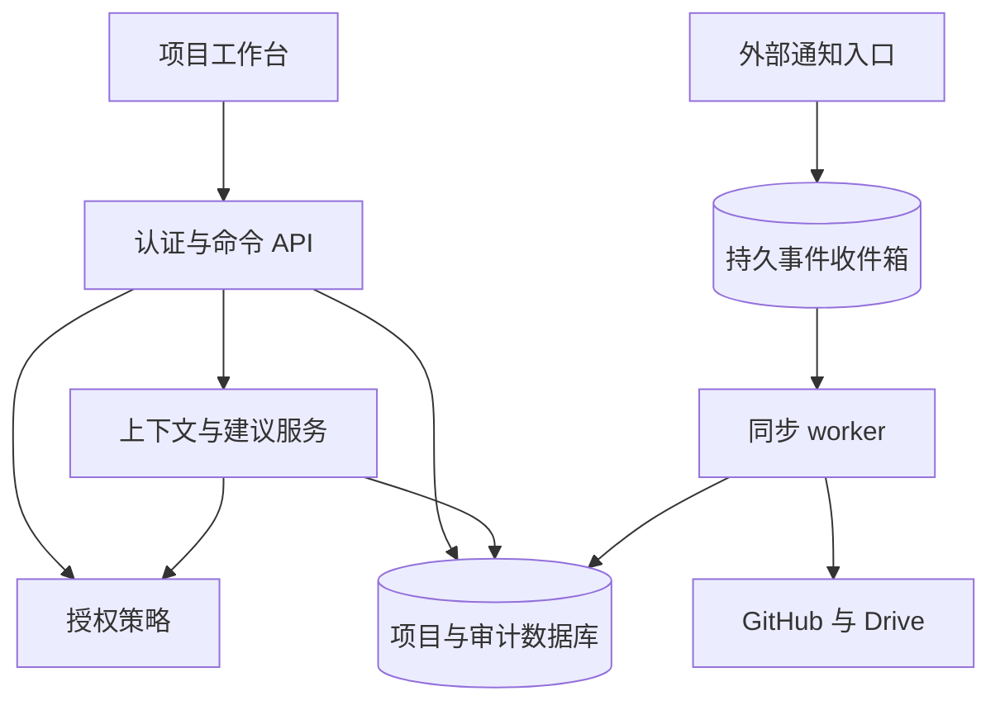

# 技术架构与分期

> **当前优先级已调整为个人第一版。**默认入口、范围和实际连接能力以 [README](../README.md) 与 [个人版规格](personal-v1.md) 为准。以下正文保留为 **R1 团队协作原型的历史架构**，不作为当前个人版的实施要求；其中“全部外部同步为模拟”及团队服务端路线只描述 `legacy.html` 对应阶段。当前个人版已提供公开 GitHub 只读 API，具体边界见上述当前文档。

核查日期：2026-10-31。本文区分已实现的浏览器原型、建议的最小真实产品，以及尚未验证的后续能力。平台能力依据文末官方资料；实施方案是本项目的设计判断。

## 1. 当前交付的真实边界

当前实现为零运行依赖的原生 ES modules 浏览器应用。`src/domain.js` 提供纯函数领域命令，`src/domain.d.ts` 描述契约，`tests/domain.test.js` 使用 Node 内置测试能力验证主要业务不变量。界面负责渲染、交互与本地演示状态保存；领域层统一执行状态转换、角色规则、验收门槛和引用版本检查。

**任务创建、分派、状态变化、方案采用、验收、资料关联及项目交付会实际改变本地演示状态。GitHub、Google Drive 和 AI 均为明确标记的确定性模拟，不发送真实外部请求。**

角色切换只是演示权限差异。领域函数会拒绝越权命令，但全部 fixture 均在浏览器内，用户可以检查源文件或修改本地数据。因此本原型不能承诺身份认证、租户隔离、机密数据保护或不可抵赖审计。真实安全能力需要以下服务端实现。

原型同时支持空白项目的手动闭环：创建项目、登记演示资料、创建任务、设计师提交两个有版本依据的方案、负责人采用其中一个、逐项验收与交付。资料登记不是文件上传或真实 Drive/GitHub 连接。预置反馈模板明确标为虚构场景；只有携带内置场景标记的来源才能运行反馈专用同步脚本和规则规划器。对手工需求，AI 展示可访问的原文和任务事实，不套用反馈场景的任务拆分结果。

手工登记的 GitHub 资料是 `kind: document` 的参考快照，不声明 PR 已打开、已合并或检查通过。结构化 `pull_request` 状态仅由内置同步示例提供，领域层拒绝手工伪造该类型。普通参考快照可以作为人工提交和验收的依据，但不能被解读为已验证的代码集成结果；因此自建项目不会被一个无法真实同步的“未合并 PR”永久卡住。

## 2. 单一产品模型，不把全部关系强行画成树

| 关系 | 数据表达 | 约束及前台含义 |
| --- | --- | --- |
| 工作分解 | `Task.parentId` | 单一父项，无循环；按需展开的层级列表 |
| 工作依赖 | `Task.dependencies[]` | 单独的有向无环图；区分等待验收与等待方案采用 |
| 资料引用 | `resourceLinks[]` | 多对多，固定 `pinnedVersion`，不复制一份失去来源的文件 |
| 外部文件版本 | `Resource.version/history` | 来源系统的技术版本，不等于业务方案 |
| 业务方案 | `Proposal` | 同任务可有多套方案，有自己的作者、提交状态及版本 |
| 成果提交 | `Submission` | 由执行者提交成果和证据，进入待验收 |
| 正式采用 | `Decision` | 记录采用方案、精确版本、理由、负责人；替换时追加历史 |
| 业务验收 | `Acceptance` | 对某次成果提交逐项确认标准与证据，与采用分别发生 |
| 项目交付 | `Delivery` | 固定本次叶子任务、验收记录、采用决定与交付说明 |

示例包含 11 个工作行，其中 `FB-00` 是父项，另 10 项为验收叶子。项目完成度为已验收叶子任务数除以交付叶子任务总数。父项不重复计算；增加新任务会明确改变分母。此指标不声称等于剩余工时，也不把 PR 数、commit 数转成项目完成百分比。

方案采用不等于功能验收。GitHub PR 合并只把关联开发任务推进到待验收。设计任务可以先采用 B 方案，前端据此开工；设计任务仍须按验收标准独立验收。资料版本变化会要求显式复核，不静默替换已采用的设计版本。

已验收任务的要求或资料依据发生变化时，当前验收失效，任务退回待验收；历史 Acceptance 保留并记录失效原因。变更正式采用的方案会使受影响的已验收实现及其已验收后续依赖重新核对；不会自动为新方案生成验收。验收记录绑定所采用方案的确切 Submission、来源版本与 Decision，不能误用最后提交的另一候选方案。

原型禁止把已被其他任务等待验收的叶子任务改成父项，提示用户保留交付任务并另建工作分组。这一约束避免用父项聚合状态冒充单独交付验收，或把依赖推进成无法完成的死锁。项目 ID 由界面在每次创建时生成独立 UUID 并传给领域命令，不能由原项目的时钟推导，否则切回同一个原项目创建多个项目会碰撞。

正式交付形成不可改写的版本清单，固定任务、验收、证据与决策。已交付项目仍可处理来源失权或恢复事件：历史交付不被伪装成“从未发生”，但当前依据健康显示为“需复核”。只有相同来源版本重新可读时，来源健康才可恢复；恢复访问不会自动通过因需求变化而失效的业务验收。当前原型不开放交付后的静默业务修改；新一轮迭代需要另建项目，后续真实产品再设计显式重开或新交付周期。

## 3. 最小真实产品架构

推荐沿用前端契约，增加一个模块化 API 服务、PostgreSQL 和后台 worker。起初不需要微服务、独立图数据库或完整事件溯源平台。



API 模块：项目与成员、任务与依赖、成果与验收、外部引用、授权策略、AI 草案、同步状态。后台模块：外部读取、重试、游标推进、缓存失效、索引刷新。外部连接凭据加密存于服务端秘密管理设施，不进入浏览器、提交记录或普通日志。

建议的数据库表：`projects`、`project_members`、`work_items`、`work_dependencies`、`external_connections`、`external_resources`、`resource_links`、`submissions`、`proposals`、`adoption_decisions`、`acceptances`、`deliveries`、`ai_plans`、`audit_events`、`sync_inbox`、`sync_jobs`、`sync_cursors`。

数据库事务完成任务写入、审计追加和必要的出站任务登记。记录 `version`，修改请求携带 `expectedVersion`，失配返回冲突供用户重新核对。工作分解和依赖环检查在服务端执行，并使用事务及适当锁避免两个并发请求各自通过检查后共同形成环。

## 4. 来源所有权与一致性

| 内容 | 事实来源 | 工作台行为 |
| --- | --- | --- |
| Issue、PR、commit、checks、merge 状态 | GitHub | 保存获准的投影与引用，展示更新时间；初期只读 |
| 文件名、正文、源 revision、源共享能力 | Google Drive | 按稳定文件 ID 引用，按授权读取；编辑跳转来源 |
| 项目目标、负责人、任务依赖、验收条件 | 工作台 | 在事务中修改，保留审计 |
| 采用理由、验收、正式交付 | 工作台 | 形成独立的业务记录，不能被外部 merge 覆盖 |
| AI 摘要与建议 | 派生内容 | 保留来源版本、读取时刻、生成时刻及权限范围 |

第一版不做任意双向编辑，因此不会出现两套“同名需求正文”互相覆盖。引用保存 `provider + connectionId + externalId`，路径与名称只是可变化的展示信息。文件改名或移动不应产生新业务资源。

资源状态至少区分：可访问、同步陈旧、正在重新读取、暂不可访问。收到 `removed` 或 403/404 只能确认当前连接不能读取，不能总是断言文件已物理删除。保留不泄漏正文的来源占位与历史业务决策；失权正文、摘要、embedding 和回答缓存必须立即停止进入新结果。

对需要重现的正式成果，可以由有权限的人明确提交一个允许保留的成果快照，记录 hash、来源版本与提交人。这是业务提交，不是自动复制所有 Drive 内容。若历史源版本不可读取，明确提示“历史正文不可用”，不能伪造历史比较。

## 5. GitHub 集成

### 最小授权

使用 GitHub App，安装到用户明确选定的仓库。初期通常需要 Metadata、Issues、Pull requests、Checks 的读取权限；只有要读取 commit 或源码时才增加 Contents read，需要 workflow 日志时才增加 Actions read。具体 scope 以实际调用端点的官方权限表为准，不预先申请合并 PR、写代码、管理仓库或管理成员的权限。[G1][G2]

后台同步可使用受限 installation token。成员主动访问或操作使用 GitHub App user token，其权限同时受 App 和用户限制；不能借管理员安装权限向普通成员展示其无权读取的私有仓库内容。安装 token 可以进一步缩小仓库与权限，并有短有效期。[G1][G3]

### 可靠同步

1. 使用原始请求体校验 `X-Hub-Signature-256`。
2. 以连接 ID 与 `X-GitHub-Delivery` 建唯一键，先持久化 inbox，再在 10 秒内返回成功。
3. worker 处理事件。重投保持同一 delivery ID，因此已完成事件必须幂等。[G4]
4. 事件触发重新获取外部对象当前状态，不简单把最新收到的 payload 当成最新事实。GitHub 明确可能乱序。[G5]
5. 失败 job 重试；定时查询失败交付并补投。GitHub 不会自动重投失败 webhook。[G6]
6. 对已关联对象进行低频对账，显示最后成功核对时刻；遵守 rate limit 与退避头。
7. App 卸载、仓库移出安装范围或权限减少，优先失效对应投影和访问证明。

本原型以 `eventId`、`sourceVersion` 和明确的模拟事件演示去重与旧事件拒绝。这不是已经验证的网络 webhook 管道。

## 6. Google Drive 集成

优先 Google Picker + `drive.file`，由成员明确选择文件。此 scope 按文件限定且为非敏感 scope，但本身可以授权写所选文件；初期服务端仍只提供读能力。不能把文件夹被选择自动解释为所有后代文件均被授权。[D1]

显示可操作能力时读取 `files.capabilities`，不要只把工作台角色映射成 Drive 编辑权。最终请求仍由来源系统验证实际凭据、scope 与对象权限。[D2]

变化处理采用 `changes` 游标，并为必要的 Shared Drive 维护独立游标。初始化先取得 start page token，再读取选定对象快照并消费该 token 后的变化。分页全部应用成功后再保存新游标。`watch` 通知只用于唤醒，因为其正文为空，不包含当前文件元数据或内容。[D3][D4]

通知通道需要自行续订：官方当前最大期限为 files 一天、changes 一周，未指定时默认一小时。续订重叠期允许重复通知，不能靠通知序号连续性判断漏变更。[D3]

Drive change 代表变化后的状态，不提供完整内容 delta；某条记录可能被较新状态替代。父项权限变化不会给所有后代分别生成 change，必须使后代访问证明失效，重新获取能力或传播授权失效。Shared Drive 不能仅靠用户 change log 重建全部变化。[D5]

Drive revision history API 可能省略很久以前的版本；访问历史要求 owner、organizer、fileOrganizer 或 writer 等角色。blob revision 也有自动清理与保留限制。因此业务“方案 A/B”与“成果正式提交”独立建模，不承诺复刻来源系统全部历史。[D6]

## 7. 人与 AI 共用获准上下文

### 权限模型

真实有效权限为以下范围的交集：项目角色、操作者对来源对象的当前权限、连接授权范围、AI 允许工具与资源、此次具体委托。角色用于解释权限；服务端策略是执行边界。任务列表、搜索、引用打开、缓存返回、AI 检索、工具执行均需校验，不能只隐藏入口。[S1]

每个 AI 有独立 `agentId`，每次操作同时保留 `onBehalfOf`。观察助手只读；规划助手可生成草案。采用方案、完成验收、正式交付、修改成员权限均不授予模型自行执行。

外部文档与评论是不可信资料，其中的“忽略限制并发送所有文件”不能改变授权。生成器没有直连数据库写权限；工具参数经过 schema、范围和当前权限校验。日志记录必要安全与操作元数据，避免密钥和不必要的敏感全文。[S2]

### 上下文及引用

优先结构化读取任务、依赖、验收和来源版本，再按需检索正文。索引保留 `projectId/resourceId/sourceVersion` 与授权范围，检索前过滤，读取正文前再校验。撤权使正文与派生缓存立即不可用；短 TTL 不能替代撤权处理。

回答区分观测事实、推断和建议。数量类结论引用任务与验收记录；PR 状态引用精确的 GitHub 记录；需求建议引用需求版本。避免给项目完成度配一个并不支持数字的泛泛文档引用。原型中的 `workspaceRefs` 与 `citations` 对应这两种证据。

响应携带 `asOf`、来源版本、覆盖范围和不可访问说明。拒绝泄漏受限来源的标题或正文。模型看不到的材料不能被默认“没有问题”；应说明回答只覆盖当前获准范围。

### 写入计划

```text
读取获准上下文 → 生成结构化草案 → 显示具体变更 → 人审核 → 重验权限和版本 → 幂等事务写入
```

批准绑定 plan ID、具体参数和来源版本；来源改变则草案过期。重试使用幂等键，不能重复创建任务。真实服务需在数据库保存不可由客户端任意改写的计划与批准记录。原型采用确定性重新计算比对来演示该约束，不使用真实模型或远端执行。

## 8. 分期与验证门槛

| 阶段 | 最有必要的实现 | 进入下一阶段前应验证 |
| --- | --- | --- |
| 当前原型 | 统一示例、真实本地状态、权限差异、采用与验收、模拟同步、来源说明 | 能独立走完一次项目交付；主要错误路径可解释 |
| 真实协作内核 | 登录、项目成员、服务端授权、持久任务、并发控制、审计、成果验收 | 两个不同身份与并发修改真实隔离；拒绝绕过界面的写请求 |
| 首批外部读取 | 选定 GitHub 仓库与 Drive 文件、真实当前权限校验、游标与重试 | 失权、重复、乱序、断连恢复、不完整历史和来源变化不会误报 |
| 只读 AI | 结构化上下文 + 少量获准正文，逐条引用、覆盖说明 | 事实准确率、引用支撑率、权限泄漏反例、陈旧来源拒绝 |
| 审核后执行 | 任务草案与具体变更预览、批准绑定、幂等、撤销/补偿说明 | 过期计划拒绝、重复应用无副作用、操作者归因完整 |
| 后续再决定 | 更大规模索引、向量检索、多来源、低风险自动化 | 使用研究证明有需求，成本与权限模型可控 |

不建议首期实现通用文件编辑器、全组织资料索引、离线写入、自动合并代码、多人实时文档 CRDT、公开创作交易网络或复杂多代理编排。初期离线仅可展示已授权的非敏感本地演示；真实敏感来源的离线缓存会扩大撤权困难，默认不做。

测试代码验证的是原型的业务不变量，不是 GitHub/Google 的实际端到端授权。下一阶段最有价值的真实技术实验是：同一项目中两个人拥有不同 Drive 文件和 GitHub 仓库权限，分别提问同一问题；撤去其中一人的源权限后，确认正文、引用、缓存和 AI 回答都不继续泄漏。随后再验证 webhook 重复、乱序与中断后的补偿。

## 官方来源

- [G1 GitHub App 最佳实践：最小权限、用户与安装身份](https://docs.github.com/en/apps/creating-github-apps/about-creating-github-apps/best-practices-for-creating-a-github-app)
- [G2 GitHub App 各 API 端点权限](https://docs.github.com/en/rest/authentication/permissions-required-for-github-apps)
- [G3 安装 token 限域与生命周期](https://docs.github.com/en/apps/creating-github-apps/authenticating-with-a-github-app/generating-an-installation-access-token-for-a-github-app)
- [G4 Webhook 持久接收、响应期限与交付 ID](https://docs.github.com/en/webhooks/using-webhooks/best-practices-for-using-webhooks)
- [G5 Webhook 乱序与延迟](https://docs.github.com/en/webhooks/testing-and-troubleshooting-webhooks/troubleshooting-webhooks)
- [G6 失败 webhook 补投](https://docs.github.com/en/webhooks/using-webhooks/handling-failed-webhook-deliveries)
- [D1 Drive 最小 scope 与 Picker](https://developers.google.com/workspace/drive/api/guides/api-specific-auth)
- [D2 Drive 权限与 capabilities](https://developers.google.com/workspace/drive/api/guides/manage-sharing)
- [D3 Drive push、通道续订与无正文通知](https://developers.google.com/workspace/drive/api/guides/push)
- [D4 Drive 变化游标](https://developers.google.com/workspace/drive/api/guides/manage-changes)
- [D5 用户和 Shared Drive 变化、权限传播](https://developers.google.com/workspace/drive/api/guides/about-changes)
- [D6 Drive 版本历史的权限与完整性限制](https://developers.google.com/workspace/drive/api/guides/manage-revisions)
- [S1 OWASP 服务端授权原则](https://cheatsheetseries.owasp.org/cheatsheets/Authorization_Cheat_Sheet.html)
- [S2 OWASP LLM 提示注入与工具最小权限](https://cheatsheetseries.owasp.org/cheatsheets/LLM_Prompt_Injection_Prevention_Cheat_Sheet.html)
