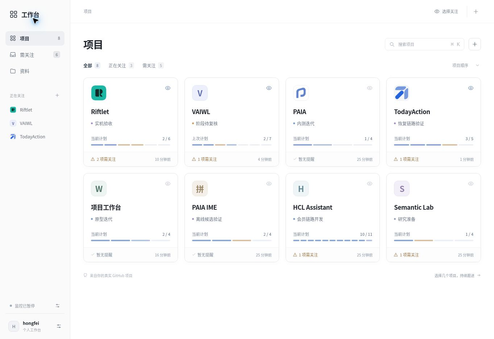
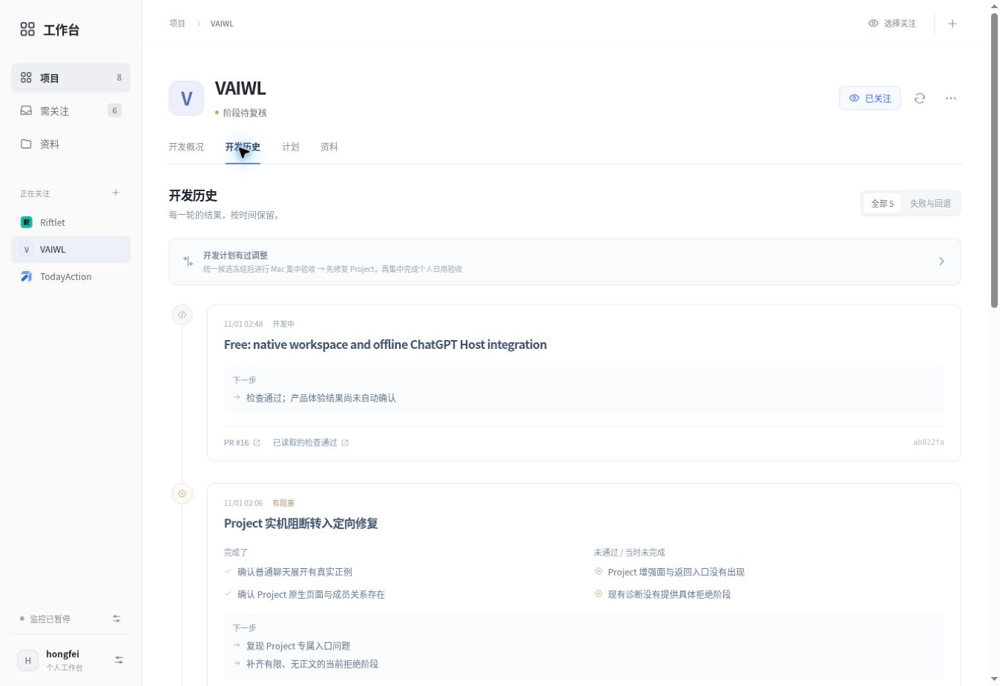
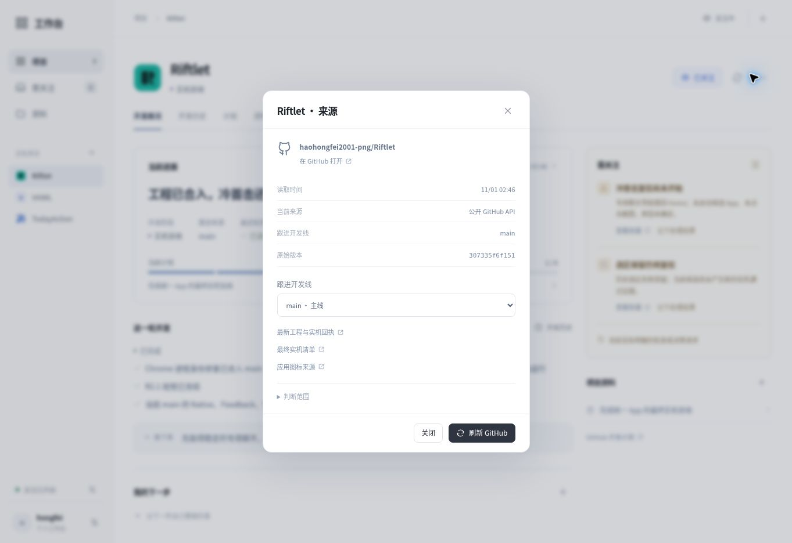
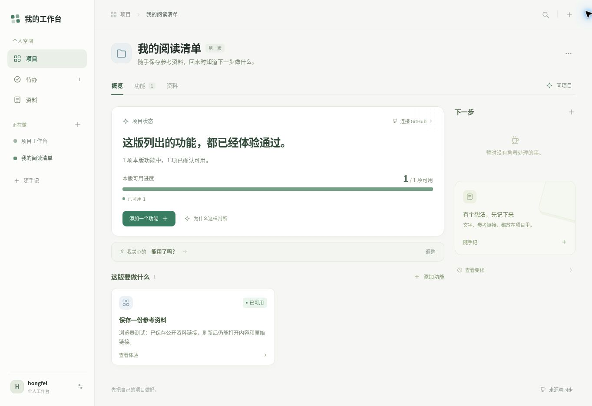
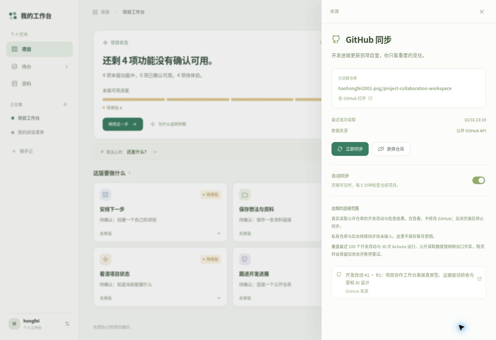
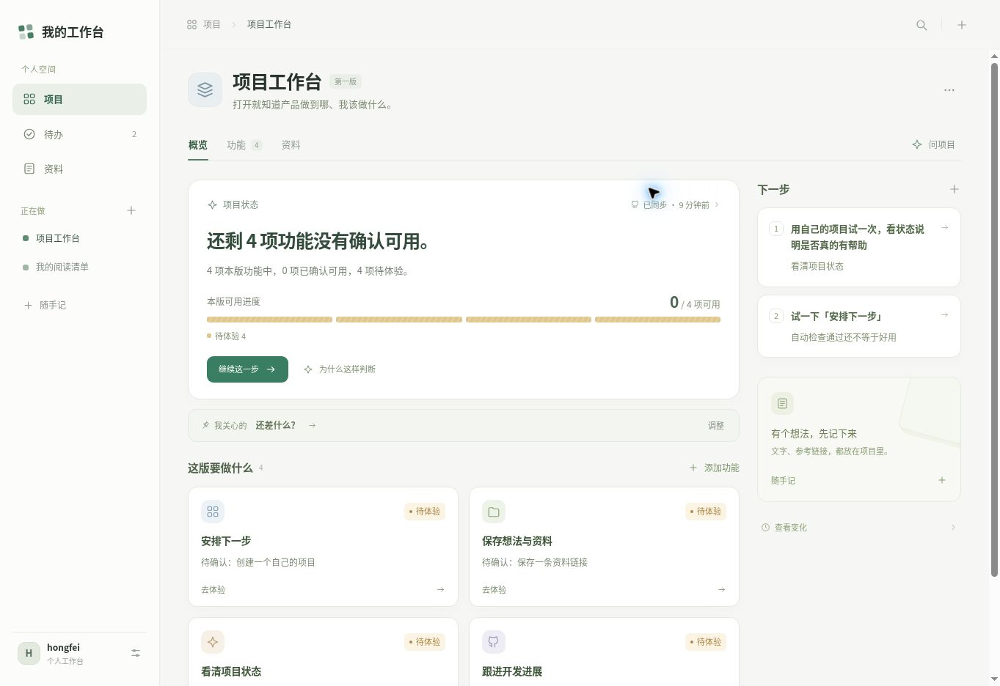
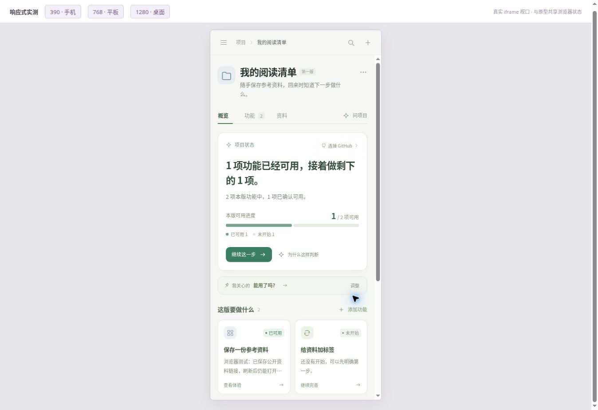
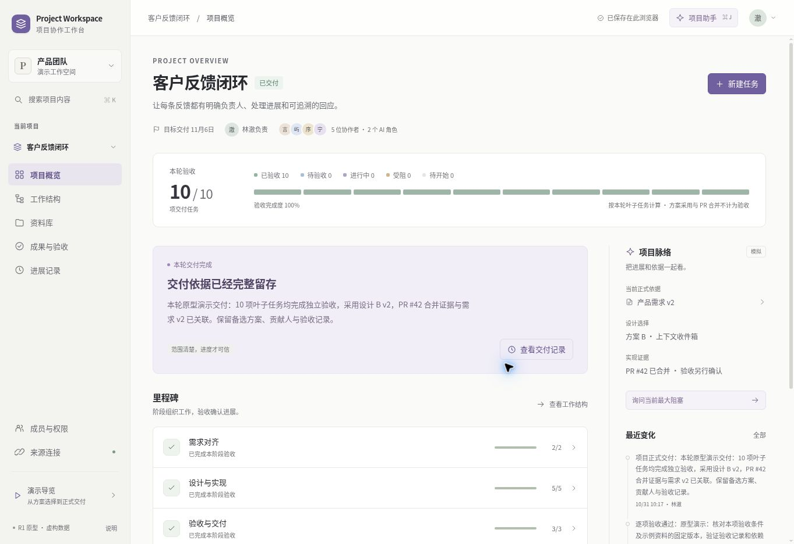
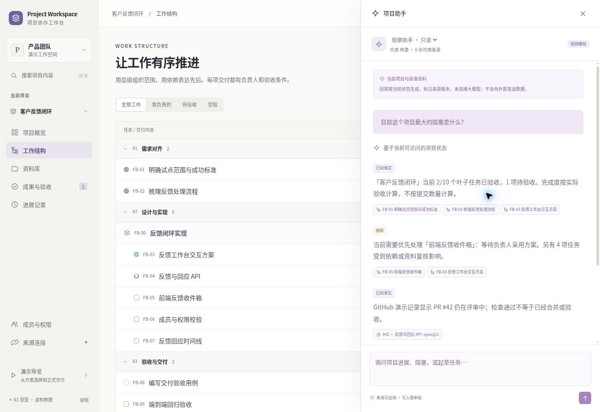
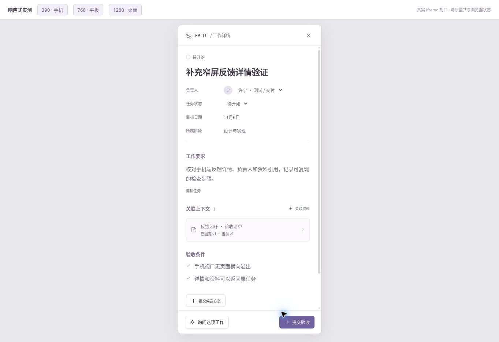

# R2 最新验证索引

2026-10-31 UTC（北京时间 2026-11-01）。当前入口已接到 R2 服务端工作台；**产品准入仍为 NO GO**，不能把以下旧版 94 项测试或历史截图当作 R2 当前提交的完整验收。

最新完整记录见 [R2 验证及准入](r2-verification.md)，部署与恢复见 [R2 运行手册](r2-operations.md)。当前已取得的证据：

- 本地 GitHub 适配 20 项、AI 33 项、UI 18 项、PGlite 服务端集成 34 项、数据库 TLS 配置 6 项、入口/调度 20 项最近运行通过；恢复补投的新测试和最终当前 SHA 的完整 CI 结果单独登记。
- 实际公开 GitHub collector 发出 24 次只读 GET，得到 411 条事实观测，全部为部分覆盖；[receipt](evidence/r2-real-read.json) 明确保留游标、时间、版本和限制。
- 首次 R2 Vercel 预览已 READY，未授权访问实际返回 302；限时授权访问 bootstrap 返回 200、configured=false 和空项目列表。后台服务尚未齐备，没有冒充实时项目状态。
- 真实付费 AI、GitHub App 安装/私有仓库、目标数据库与关闭浏览器后完整旅程尚未验收；同源模型比较为 NOT_RUN。

最终提交 SHA、远端 CI、最新预览部署 SHA 与具体剩余阻断统一填写在 [r2-verification.md](r2-verification.md)，避免把不同版本的验证混在一起。以下 Watch V1、个人 V1 与 R1 原始记录保留，不追溯改写其历史结果。

---

# Watch V1 验证记录与证据

2026-11-01（Asia/Shanghai）。当前默认入口是白底的真实项目工作台；后文保留个人 V1 与 R1 的历史验证。本节只报告本轮实际执行的结果。

## 1. 构建与领域验证

执行 `npm ci --ignore-scripts`、`npm run check` 成功。**39 项监控领域/适配器测试 + 23 项个人版测试 + 32 项 R1 回归测试，共 94 passed，0 failed，0 skipped。** 脚本语法、静态构建与最终内嵌 JavaScript 编译通过。

| 产物 | 实际结果 |
| --- | --- |
| 当前独立原型 | `dist/Project-Workspace-Watch-V1.html` |
| 大小 | 285,362 bytes |
| SHA-256 | `e1d3ca2af192a8752f529b16d1cd1174eb9c2e59f7dc725c5abc296dbc1d9be9` |
| 外部脚本 / 样式依赖 | 0 / 0；图标也已内嵌 |
| 原始命令输出 | [watch-validation-20261101.log](evidence/watch-validation-20261101.log) |
| 浏览器观测清单 | [watch-browser-checks-20261101.json](evidence/watch-browser-checks-20261101.json) |

CI 配置执行相同命令并上传 `project-workspace-watch-v1`。远端结果以 PR 对应最新提交的 Checks 为准，不能用之前版本的绿色结果替代本轮结果。

39 项当前测试验证了实际风险：未明确的整体分母不能伪造百分比；当前检查必须匹配开发线与代码版本；历史失败与当前阻断分开；Draft 和无活动不自动等于审批或卡住；处理记录绑定确切事项；新版本、相关评论、新检查和计划变更使旧判断待复核；旧事件不覆盖新数据；新版本成功不删除已观察失败；同版本重试保留旧依据；同 SHA 不同人工回合不能合并丢失；计划不可读保留旧正文；读取窗口遗漏新讨论不能恢复旧结论；限流、覆盖不足、缺失 PR、私有仓库边界和计划路径验证等。见 [watch.test.js](../tests/watch.test.js)。

## 2. 首页与个人操作

在 1363 × 936 的 Chromium 视口中，初始八个真实项目排成 **四列、两行**，每张卡片宽 **260.75 px**、高 **246 px**。卡片只保留应用图标、名字、阶段、计划计数、提醒与读取时间，没有介绍段落。



通过真实页面操作验证：

- 关注 PAIA 后，关注数从 3 变为 4；重新加载仍保留，再恢复为 3。
- 在 `scripts/watch-qa.html` 的独立测试存储中添加真实公开仓库 Context Tabs，项目从 8 张变成 9 张，未读取前显示未知而非虚构进度。
- 创建、修改资料及下一步，完成待办，刷新后重新打开资料，内容和完成状态仍在；用项目选择器将资料移到 PAIA，全局资料页显示正确归属。
- 给 VAIWL 写本地处理记录，刷新后在“我的处理记录”查看；界面明确说明没有修改 GitHub，不把记录当作修复或批准。
- VAIWL 的“失败与回退”从 4 条已核对回合筛出 3 条；计划可对照前后版本。

实际下载的测试状态：[watch-browser-state-20261101.json](evidence/watch-browser-state-20261101.json)。新增资料与待办明确带“原型测试”字样，不代表真实使用成果；测试入口与默认八项目目录隔离，未向浏览器注入状态。

## 3. 真实 GitHub 更新与开发历史

浏览器确实发出了公开 GitHub API 请求。默认工作台自动读取了 Riftlet（北京时间 02:46）、VAIWL（02:51）、TodayAction（02:54）；另在独立测试入口手动读取 VAIWL（02:53）。公开只读快照保存在 [watch-live-state-20261101.json](evidence/watch-live-state-20261101.json)，来源字段为 `github-public-api`。

其中 VAIWL 在测试期间从已整理的 `5593e02` 推进到 `ab022fa`。界面把新开发事实加入历史，并将旧计划、阶段和产品解释标为待复核，保留之前 Mac 实测失败的回合。新版本的检查通过没有被解释成项目页已修复。



项目来源中实测将跟进开发线从 PR #16 切换到 PR #24，再切回；选择变化可见，旧结论维持待复核。计划原文与确切来源可展开。Riftlet 实际读取后仍以 main 的当前检查为依据，没有把无关 PR 的检查当作当前主线状态。



自动读取是在开启监控和预览切换过程中观察到的，**没有把多次重新加载当成一次完整、连续的三项目三十分钟调度验证**。最终调度会参考已保存的最近成功读取时间，避免重新加载后立即重复请求；仅在页面可见时每十分钟轮询一个项目，关闭页面停止。验收结束已暂停监控，三个关注选择保留。

## 4. 响应式与独立产物

| 实际视口 / 页面 | clientWidth / scrollWidth | 观察 |
| --- | --- | --- |
| 1363 × 936 首页 | 1363 / 1363 | 4 列，8 张卡片 |
| 1280 × 900 首页 | 1280 / 1280 | 4 列，卡宽 240 px |
| 1280 × 900 计划 | 1265 / 1265 | 双列计划；15 px 为纵向滚动条 |
| 768 × 1024 首页 | 753 / 753 | 3 列；没有横向页面溢出 |
| 390 × 844 首页 / 概况 / 计划 | 375 / 375 | 首页 2 列；计划上下排列 |

响应式通过真实 iframe 视口检查，不是缩小桌面截图。手机导航抽屉可打开和关闭，进入项目、开发历史与计划均可操作。收起的抽屉不留在可聚焦区域。实际手机版截图见 [watch-mobile-390-20261101.jpg](evidence/watch-mobile-390-20261101.jpg)。

最终独立 HTML 通过本地 HTTP 打开，实测搜索、项目导航和开发历史；DOM 中外部脚本与外部样式表均为 0。项目来源弹窗的 Shift+Tab / Tab 首尾循环通过，Esc 关闭后焦点回到来源按钮。应用地址下未观察到控制台错误；浏览器扩展自身的 metadata 错误不记为应用错误。

## 5. 本轮没有实现或证明的能力

当前没有真实模型调用、私有仓库授权、后台持续事件接收、跨设备存储或生产权限后端。已整理的产品解释是本轮依据真实资料制作的快照；自动读取会新增事实、提示旧判断待复核，不能自动理解每条开发讨论或代码差异。没有宣称已优于高质量 GPT 问答。

限流和乱序等异常由适配器/领域测试验证，没有冒称在浏览器中实际制造了所有异常。未做真实手机操作系统和软键盘测试、所有浏览器的 `file:` 协议测试、完整 WCAG 审核或强制网络延迟的 UI 竞态压力测试。

---

# 个人 V1 历史验证记录与证据

2026-10-31（北京时间）。以下是上一版个人原型的历史验证；当前默认入口已改为上文 Watch V1。各版本真实连接、数据与验证范围不能混用。

## 本轮实际结果

在 Node.js 24.22.1 中执行 `npm ci --ignore-scripts` 和 `npm run check`，命令成功退出。个人版 **23 项测试**与 R1 **32 项回归测试**全部通过，合计 **55 passed，0 failed，0 skipped**；脚本语法检查、静态构建及最终内嵌脚本编译通过。

| 产物 | 结果 |
| --- | --- |
| 当前独立原型 | `dist/Project-Workspace-Personal-V1.html` |
| 大小 | 124,543 bytes |
| SHA-256 | `5fb37a9dec8f4d6a888a63110258397302e02a119d8130e045787a35a42bf916` |
| 运行时依赖 | 0；无外部脚本或样式表 |
| 本地原始输出 | [personal-validation-20261031.log](evidence/personal-validation-20261031.log) |
| 浏览器观测 | [personal-browser-checks-20261031.json](evidence/personal-browser-checks-20261031.json) |

GitHub Actions 执行同一检查并上传构建产物；远端结果以 PR 对应提交的 Checks 为准，不用旧 R1 的 CI 或本地测试替代新提交的 CI。

## 1. 从自己的空白项目开始

全部通过实际页面按钮、表单与导航操作，没有向浏览器注入应用状态。

1. 创建“我的阅读清单”，目标为“随手保存参考资料，回来时知道下一步做什么。”，没有连接 GitHub 或设置团队。
2. 添加“保存一份参考资料”，填写两个体验条件；保存一条关于公开仓库同步的笔记及 GitHub 官方文档链接，关联下一步“检查刷新后资料是否还在”。
3. 刷新页面后重新打开资料，文本与链接仍在；逐项勾选体验条件并记录体验结果，本版可用进度从 **0/1 变为 1/1**；完成待办。
4. 在手机尺寸编辑资料，在桌面修改待办；再次以**只填功能名称**的方式添加“给资料加标签”，进度随本版范围变为 **1/2**，没有把新增范围伪装成开发倒退。
5. 用第二个标签页修改内容，同时保留另一个标签页的正在填写的表单。实际操作中的新笔记与待办都保留；这不代表已实现多用户并发数据库。

实际从设置下载的状态：[personal-browser-state-20261031.json](evidence/personal-browser-state-20261031.json)。其中阅读清单是测试中创建的项目；工作台的 GitHub 数据来自真实公开读取。文件是可审查的测试快照，不代表用户已经日用或完成产品价值验证；当前没有 UI 导入恢复。



## 2. 真实公开 GitHub 同步

本轮浏览器实际读取 `haohongfei2001-png/project-collaboration-workspace` 的公开 GitHub API，来源标识从内置的连接器读取快照更新为“公开 GitHub API”。**23:03 手动读取成功；开启自动同步后，没有再次点击同步，23:10 又成功读取一次**，导出快照的读取时间为 `2026-10-31T15:10:01.501Z`。测试结束后关闭自动同步。

自动同步只在当前项目、页面可见且没有弹窗或详情操作时工作，间隔至少五分钟；关闭页面后不工作。范围为仓库信息、最近更新的最多 100 个 PR、最近 30 次 Actions。没有读取源码、私有仓库、Drive 或所有历史记录。



同步失败、限流、缺少检查、读取不完整等分支由适配器测试验证；没有把模拟错误响应写成浏览器中实际遭遇限流。旧请求取消和仓库切换后的响应归属已在实现中处理，本轮没有进行强制网络延迟的完整竞态压力测试。

## 3. 状态说明、安静的记录与响应式

| 实际操作 | 观察结果 |
| --- | --- |
| 把关注点改成“还差什么？” | 首页主结论随关注问题改变，而非只改变标签 |
| 问“我现在该做什么？” | 回答当前项目的实际待办；依据可展开到 PR 和对应检查 |
| 点击“我看过了” | 已读差异清空，显示没有新的变化，不回退展示旧变化 |
| 手机添加功能 | 名称是唯一必填项；开发关联和体验条件收在展开层 |
| 在单文件产物搜索 | 可找到刚创建的真实测试项目 |
| Esc 关闭弹窗 | 焦点返回入口按钮 |
| 弹窗 Tab / Shift+Tab | 首尾焦点循环有效 |

| Chromium 内实际视口 | 文档 clientWidth / scrollWidth |
| --- | --- |
| 390 × 844 | 390 / 390 |
| 768 × 1024 | 768 / 768 |
| 1280 × 900 | 1280 / 1280 |
| 1363 × 936 | 1363 / 1363 |

手机检查包括导航抽屉、资料编辑与功能创建；没有将缩小桌面截图当作手机适配。最终单文件通过本地 HTTP 打开，DOM 检查为 0 个外部脚本、0 个外部样式表。





## 4. 领域测试覆盖的具体风险

个人版的 23 项测试覆盖功能范围与可用进度、部分功能已可用时的准确结论、体验确认绑定开发版本、相同版本合并后保留确认、新版本使当前确认待复核、失败检查优先于确认、检查必须匹配 PR 代码版本、缺失检查保留未知、用户报告问题后重新确认、未改变体验条件不误清除确认、任务与笔记编辑、仓库切换清除旧映射、旧快照不覆盖新状态、重复同步保留未读差异、状态依据及未知问题、公开读取的错误与限流等风险。具体断言见 [personal.test.js](../tests/personal.test.js)。

## 尚未验证或实现

**项目回答是规则版，没有调用大模型，也没有证明比高质量 GPT 问答更准确。** 当前价值假设是持续保留个人目标、更新状态、可视化功能覆盖并保留下一步；需要本人真实日用和同来源对比来验证。

没有私有仓库授权、后台持续同步、源码语义分析、真实 Drive、服务器鉴权、云端备份、跨设备同步、生产多用户并发、真实手机软键盘兼容、完整 WCAG 审核或全部浏览器的 `file:` 协议测试。双击文件若遇到浏览器存储或网络限制，应使用 README 的本地服务方式。自动化通过与 UI 可操作不等于真实用户收益已经成立。

---

# R1 历史验证记录（旧协作原型）

## 结论及适用范围

本轮已完成可运行原型的本地构建、32 项领域测试、实际浏览器主要流程、独立 HTML 运行及基本响应式检查。测试对象是本仓库的 **R1 本地原型**；示例成员、资料、代码状态、验收结论及交付事件均为虚构。以下结果不代表真实团队已经交付软件，也不代表生产鉴权、真实 OAuth、真实模型质量或商业效果已经验证。

执行日期：2026-10-31。最终本地环境：Node.js **24.22.1**、npm **11.9.0**。浏览器为云端 Chromium，桌面实际视口 **1363 × 936**；响应式使用本仓库测试页内的真实 iframe 视口。

## 1. 可重复的构建与领域测试

执行命令：

```bash
npm ci --ignore-scripts
npm run check
```

`check` 顺序执行应用与领域脚本语法检查、真实领域测试和静态构建。构建同时编译检查最终内嵌 JavaScript，不只检查源文件。

| 检查 | 实际结果 |
| --- | --- |
| 依赖安装 | 退出码 0；零第三方运行时依赖 |
| 应用 / 领域语法检查 | 通过 |
| 领域测试 | **32 passed，0 failed，0 skipped** |
| 静态构建 | 退出码 0 |
| 独立 HTML 内嵌脚本编译 | 通过 |
| 独立 HTML 体积 | 243,094 bytes |
| SHA-256 | `944176649a103e826e95df97ed351b8bf1138a9189b091f9da56c7f00e4d65ae` |

原始输出见 [validation.log](evidence/validation.log)。日志里的 npm `http-proxy` 提示来自执行环境配置，不是本项目依赖或构建错误；命令均成功退出。GitHub Actions 已配置相同检查和构建产物上传；远端实际结果见本 PR 的 Checks，不以本地通过替代远端结果。

### 测试覆盖的主要风险

| 风险 | 已执行的验证 |
| --- | --- |
| 不可信进度 | 只计叶子任务；五种有效状态互斥；父项不重复计数；依赖和版本复核影响当前状态 |
| 越权写入 | 直接调用命令入口拒绝观察者、AI、未知身份；成员不能重指派或修改他人任务 |
| 工作关系错误 | 工作树与依赖图分别检查循环；拒绝会让已有验收依赖无法满足的父子改造 |
| 采用 / 验收混淆 | 采用锁定确定版本，保留备选与理由；采用不直接验收；重新采用可使下游验收失效 |
| GitHub 同步误判 | 合并只进入待验收；重复事件幂等；旧事件不覆盖新投影 |
| Drive 更新与撤权 | 新版本不替换固定引用；必须明确复核；撤权后正文不进入选择器和 AI；恢复不伪造验收 |
| AI 审批错配 | 草案内容与来源版本必须准确匹配；项目或来源变化使草案失效；重复执行不重复建任务 |
| AI 引用装饰化 | 状态判断引用实际工作记录；资料引用绑定版本；指定任务只回答该任务的实际上下文 |
| 人工新项目无法完成 | 空白项目从资料登记、两套设计提交、采用、验收到交付可闭环 |
| 手工 GitHub 参考死路 | 手工快照不冒充结构化 PR；正常人工验收可完成，不伪造 merged / checks |
| 交付后资料变化 | 保留历史交付快照，同时提示当前证据不可用，不倒改历史 |

测试中包括内置 10 项叶子任务的完整交付、Drive v3 逐项复核后的完整交付，以及空白项目的人工闭环。见 [tests/domain.test.js](../tests/domain.test.js)。

## 2. 实际浏览器操作

这些检查通过页面控件、输入框、选择器和按钮完成，没有从浏览器开发接口直接注入应用状态。

### A. 从空白项目开始的闭环

实际创建“客户反馈试点 · 交付验证”，填写目标，创建 `PW-01 反馈分诊入口设计`，指派给沈言并关联项目目标。切换沈言后，更新任务状态、修改自己的工作要求；负责人控件不可重指派。

随后由沈言登记两份 Drive 模拟设计快照，正式提交方案 A 和 B。切换林澈后比较并采用 B v1，逐项确认两个验收条件及证据，进度从 0/1 变为 1/1，再确认交付。刷新后仍显示“已交付”，项目选择器同时保留原有“客户反馈闭环”。

证据：[空白项目交付截图](evidence/delivery-flow.jpg)。

### B. 同一个内置项目从 2/10 到正式交付

恢复示例后，采用设计 B v2，同步 PR #42 合并，再通过 UI 逐项操作：

| 阶段 | 实际操作与结果 |
| --- | --- |
| 初始范围 | 10 项叶子任务，FB-01 / FB-02 为预置已验收，进度 2/10 |
| 设计 | 采用 B v2 并写理由；采用本身不增加已验收数；独立验收 FB-03 |
| 后端 | PR 合并后 FB-04 待验收；明确验收后进入已验收 |
| 实现 | FB-05、FB-06、FB-07 分别正式提交并逐项验收；依赖随上游验收解除 |
| 测试与交接 | FB-08、FB-09、FB-10 分别正式提交并逐项验收 |
| 整体结果 | 10/10、三个里程碑分别 2/2、5/5、3/3，仍需负责人确认交付 |
| 最终交付 | 填写交付说明并确认；刷新后仍为已交付；21 条项目事件、10 条验收记录 |

实际浏览器导出文件：[completed-demo-state.json](evidence/completed-demo-state.json)。文件中的业务内容及预算为种子演示数据；页面显示的事件时间来自可复演的演示时钟，实际测试时间记录在验证日志中。导出文件用于审查，不是生产数据备份，也没有声称支持 UI 导入。



### C. 同步、AI 与权限差异

| 操作 | 观察到的结果 |
| --- | --- |
| 重复点击 PR 合并同步 | 只保留一个合并事件，不重复创建任务或验收 |
| 同步需求 v3 | 已固定的 v2 引用保留；相关当前验收需要重新确认；原记录保留 |
| 从 AI 点击需求引用 | 打开确切的 v3 来源快照，能看到各任务仍固定 v2 |
| 在 FB-05 复核新依据 | 只更新该任务至 v3，不批量替换其他任务 |
| 规划助手生成任务草案 | 展示标题、说明、负责人、阶段、日期、验收条件、依赖、上级工作与来源版本 |
| 负责人批准草案 | 真正创建 FB-11 / FB-12；审计显示规划助手及“由林澈授权” |
| 需求来源失去授权 | 观察助手可用来源从 6 降为 5，回答不再包含需求正文与需求引用 |
| 恢复来源 | 后续上下文重新读取可用来源，不复用旧回答 |
| 切换顾乔 | 资料列表不显示预算；越权操作被命令层拒绝；完整导出被拒绝 |
| 手机端询问手工任务 FB-11 | 只描述该任务的负责人、要求、实际依赖与验收资料，不套用 FB-05 的预置故事 |



## 3. 响应式与独立构建

| 视口 | 实际检查 | 宽度观测 |
| --- | --- | --- |
| 1363 × 936 | 概览、工作表、资料、方案比较、任务侧栏、AI、成员权限、验收交付 | 文档宽度 1363，无页面横向溢出 |
| 1280 × 900 | 概览与工作区域 | 文档宽度 1280 |
| 768 × 1024 | 工作列表、资料表、导航 | 文档宽度 768；资料主区 clientWidth / scrollWidth 均为 580 |
| 390 × 844 | 导航抽屉、实际填写任务并指派 QA / 关联资料、全屏详情、任务 AI | 文档宽度 390，无页面横向溢出 |

视口是在 Chromium 中真实改变 iframe 尺寸，触发应用媒体查询；没有用缩小截图冒充移动适配。这不等于实际 iOS / Android 触控、软键盘和系统浏览器兼容测试。平板截图记录的是当时可见的滚动区域。



单文件 `dist/Project-Workspace-R1.html` 已在浏览器通过本地 HTTP 实际打开，完成恢复示例、搜索、退出操作；DOM 检查为 **0 个外部脚本、0 个外部样式表、1 个内嵌脚本**。已验证 Esc 关闭后焦点回到入口，以及模态框 Shift+Tab / Tab 首尾循环。未将一次自动化快捷键触发失败算作通过；跨平台全局快捷键与真实读屏兼容仍需后续检查。

单文件可以下载后用浏览器打开；本轮没有把本地 HTTP 检查等同于所有浏览器的 `file:` 存储策略验证。若双击后存储受浏览器限制，使用 README 的本地服务方式。

最后采集的浏览器日志中，过滤明确来自 `chrome-extension://` 的环境元数据错误后，没有应用错误或警告。日志采集范围是该页最近 500 条记录，不是全生命周期监控或性能认证。

详细观测：[browser-checks.json](evidence/browser-checks.json)。

## 4. 验证中发现并已修复的问题

- 新项目 ID 可能冲突，改为调用方生成唯一 ID，并在领域层校验。
- 把已有交付依赖目标改成父项可能造成死锁，改为明确拒绝。
- 重新采用另一方案后旧实现验收仍有效，增加相关验收及下游失效规则，保留历史。
- 成员编辑自身任务时，未变更的负责人字段误触发重指派权限，修正 UI payload 与领域判断。
- 空白项目缺少资料登记和正式方案提交入口，补齐实际人工闭环。
- 观察者可导出完整状态，改为仅负责人可导出。
- AI 审批未展示所有拟写字段，补齐完整变更预览。
- 手工 GitHub 来源被当作永远不能合并的 PR，改为普通参考快照，禁止伪造结构化 PR 状态。
- 手机导航被 CSS 层级优先级隐藏，修复可见性，并重新实测创建流程。
- 验收队列混淆已提交但受阻与可验收，增加可验收 / 需复核区分，并统一状态筛选。
- 任务 AI 入口回答整个预置项目，增加基于明确任务 ID 的受权定向回答。
- Esc 关闭对话框后焦点未返回入口，修复并在最终单文件构建中验证。

## 5. 本轮没有验证或实现的能力

没有真实 GitHub App、Google OAuth、多人并发服务、生产 ACL、真实模型问答质量、实时编辑、离线写入合并、压力测试、跨浏览器全量兼容或 WCAG 完整认证。里程碑和角色仍为预设；AI 草案仅支持内置反馈需求的规则生成，整份批准或放弃；正式成果编辑、部分批准、完整评论和请求修改流程尚未实现。

这些限制在界面、README、产品设计及技术架构中均有区分。下一阶段的证据应来自真实团队任务观察和受控的只读集成试点，不应把本轮可点击、测试通过或模拟验收当成真实用户价值已经成立。

